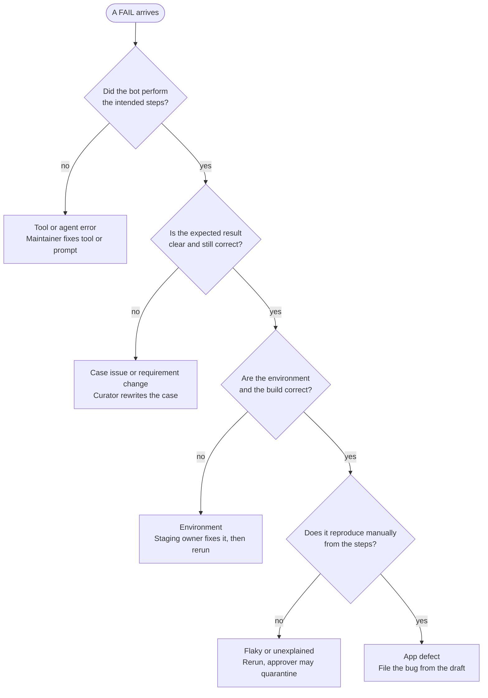

## Reading results and triage

Every FAIL, BLOCKED, INCONCLUSIVE, and INCOMPLETE result goes to a person, and only a PASS with evidence counts as verified.

**Report anatomy**

- Header: the build, the configuration, and the model, prompt, tool, and browser versions.
- Summary line in this form: "bot executed X of Y planned cases, Z not verified". Never write "all tests passed".
- Per case: verdict, rationale, step list with screenshots, console and network errors, and a trace or video link.
- For a FAIL: expected vs actual, and a draft bug report.

**How the report is made.** The report is a view over the stored run records and the plan, and no model writes any part of it. The bot stores it as `report.json` (the contract, with a JSON Schema in `schemas/report.schema.json`) and `report.txt` (the same report as text). The command `run` ends with one, and `report` builds one from run records already on disk.

- **The summary line.** Y is every case in the plan, including a case that never started. X is the planned cases that have an accepted run record, whatever their verdict. Z is Y minus the cases that are PASS, so a case that did not run counts as not verified, and only PASS is verified. A case that ran and ended FAIL, BLOCKED, INCONCLUSIVE or INCOMPLETE is therefore also not verified, and the line under the summary names every kind ("Not verified: FAIL 1, INCONCLUSIVE 1, not executed 1"). A case file that does not validate is rejected before its run and counted as not executed, and the rest of the batch still runs. The line is built in one place, and a stored report whose counts do not match its cases is invalid. When the plan was not declared and is only the runs given, the report says so, because it cannot count a case that never ran.
- **The reporter does not take a record's word for its verdict.** It recomputes the verdict from the stored outcomes and run state with the precedence table, and a PASS needs stored evidence for every expected result. A record that fails either check is reported as not executed, flagged for a maintainer, and its verdict is not shown. A record from an older schema version is not trusted for its version stamps.
- **Version stamps.** The header gives the target, build, configuration hash, model ID, judge model ID, actor and judge prompt hashes, the bot version and a hash of the bot's source files and lockfile (which also shows an edit that was never committed), and the Node, Playwright, axe-core and browser versions, and whether the browser sandbox was on. It also says whether the model and the judge were live or scripted fakes. A stamp a run could not record is shown as missing, never filled in, and the report says it cannot show everything that produced it. Runs that disagree on a stamp are shown as mixed, and each case keeps its own values. The configuration hash leaves out the paths that differ between machines.
- **Rationale.** One sentence per case, built from the run's own facts. The rules themselves stay on the Definitions page.
- **Draft bug report.** For a FAIL it holds the title, build, configuration, role, preconditions, steps to reproduce, expected vs actual with paths to the evidence, and any step that was also blocked. The cause category is "untriaged" and the severity and priority are left for a person. The bot makes no severity suggestion. A negative control gets a draft too, marked as a control with a note that its FAIL was expected, and a person decides what to do with it.
- **Trace.** No Playwright trace is recorded, because a trace cannot be scrubbed. The report links the scrubbed network log instead.
- **Who is told.** A P1 case that is not PASS (even one that never ran), a guardrail block, an injection report, a credential found by the final scan, a failed cleanup, an invalid model report, a browser sandbox that was off, a frozen script step that could not run, and a rejected run record are each listed under "Needs a person". A run that replayed a frozen script carries a "Script" line with the script's version, its hash and the hash of the case it was frozen from, and says that no model was called (see the [frozen scripts runbook](../runbooks/frozen-scripts.md)).

**Release report.** The command `release` adds three things to a run report: the inventory of P1 cases (every case file in the configured case directory), the register of quarantines and overrides (a JSON file, kept as a decision record), and the names of the approvers and the release decision-maker (both `[to fill]` in the manual, read from configuration). It states whether the evidence for the release decision is complete. It never states the decision, because a bot PASS is evidence for that decision and never the decision (Roles and decision rights).

- **Complete evidence** means every P1 case in the inventory is PASS, quarantined or overridden, none is missing from the run, the runs saw one build, no version stamp is missing, nothing is wrong in the register or the inventory, and no quarantine is overdue. The release report also checks the run report against the run records it names: each record has to be on the machine, to hash to what the report says, and to give the verdict and outcomes the report shows, and an override's evidence has to exist (a link counts). Otherwise the report may have been changed after it was made, and the evidence is incomplete. A quarantine or an override dated after the day of the report is invalid. Evidence from a scripted model is never complete. The report lists why it is incomplete.
- **Quarantine.** Only an approver may quarantine a case, with a named owner, a reason and a deadline. A quarantined case is out of gating, and every release report lists every quarantine with the case's verdict in the run. A quarantine past its deadline puts the case back in gating. The deadline day itself still counts.
- **Override.** Only an approver may override a FAIL, with a triage result and evidence. An override names the run it is for, so it does not carry over to a later run, and the verdict stays FAIL in every report. Only a FAIL can be overridden. The register is read in full or not at all: an override without a triage result or evidence stops the report. Every override is listed, and overrides are reviewed monthly.
- **Fail closed.** With no approver configured, every quarantine and override is invalid and is shown as invalid. A case file that does not validate is a fault, because it may be a P1 case the check cannot see.
- **Not yet decided.** The release policy itself (what the decision-maker requires, and the gating stage's rules for sampling PASS results) stays on the Still to write page.

**Triage.** Work through the decision tree below, in order, for every FAIL.

Start at the top: a no answer exits to its cause, and a yes carries you down to the next question.

In words: if the bot did not perform the intended steps, it is a tool or agent error. Otherwise, if the expected result is unclear or outdated, it is a case issue or a requirement change. Otherwise, if the environment or build is wrong, it is an environment problem. Otherwise, if the failure does not reproduce manually, it is flaky or unexplained, and if it does, it is an app defect.

**Cause categories**

| Category | Meaning | Action |
| --- | --- | --- |
| Tool or agent error | The bot did not perform the intended steps | Maintainer fixes the tool or prompt and adds a golden-set case |
| Case issue | The expected result is ambiguous, outdated, or wrong | Case curator rewrites it and links the requirement |
| Environment | Staging is unhealthy, the build is wrong, or data collided | Staging owner fixes it, the run is rerun, and meanwhile it is INCONCLUSIVE |
| App defect | It reproduces manually from the steps | File the bug from the draft; a human sets severity and priority |
| Requirement change | The app changed on purpose | Update the case after the product owner confirms |

Record the category on every triaged FAIL. The tags become labeled data for the eval set.

A FAIL that does not reproduce manually is recorded as flaky or unexplained. Rerun it, and the approver may quarantine it.

**Bug report fields**

- Title, build, and configuration.
- Preconditions and steps to reproduce.
- Expected vs actual, with evidence links.
- Cause category.
- Bot-suggested severity (a draft only), then the severity and priority set by a human.

Scrub evidence before attaching it to a ticket, because traces and HAR files can hold cookies, auth headers, and request bodies.

**Rules**

- Triage target: [to fill; suggested: within one business day].
- A P1 case that is not PASS gets human execution before release (Definitions). A guardrail block (INCONCLUSIVE) is also reviewed by the security reviewer.
- Only the approver may quarantine a case, with a named owner and a deadline. Quarantined cases are listed in every release report.
- Overriding a FAIL needs a recorded triage result and the approver. Overrides are reviewed monthly.

**Challenging a verdict.** Anyone may challenge a verdict through [to fill: form or channel] and gets a response within [to fill: target]. The outcome is recorded, and every accepted challenge becomes an eval example.
